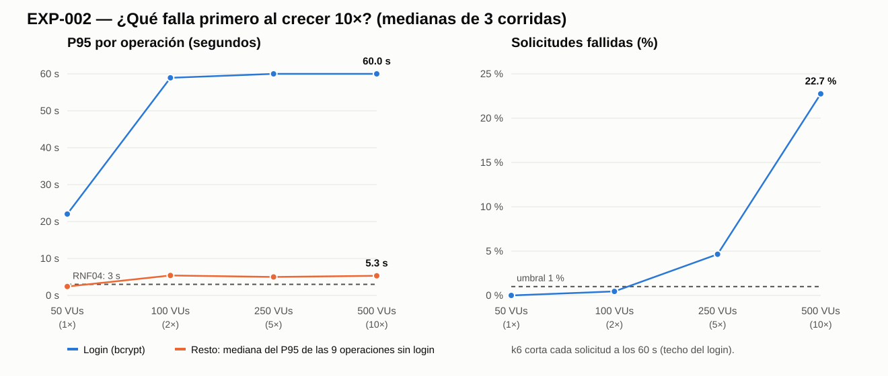

# EXP-002 — Crecimiento 10× — Resultados y veredicto

- **Pre-registro:** `00-preregistro.md`, commit `02a5143` (antes de medir).
- **Ejecución:** 2026-10-23, 18:26–18:47 (−05:00); datos crudos en el commit `0434d99`.
- **Commit medido:** `02a5143` (imagen de la API reconstruida sobre ese commit; sin cambios de código).
- **Protocolo:** calentamiento a 50 VUs (descartado) + 3 corridas de 60 s por nivel; se reportan **medianas de las 3 corridas** (`scripts/analizar.js` → `resultados/mediana-por-nivel.json`).



## 1. Dónde y cómo se degrada el sistema

### 1.1 Recursos (mediana de las muestras de `docker stats` durante cada corrida)

| Nivel | CPU API | CPU PostgreSQL | Conexiones activas en PG* | Solicitudes HTTP | Solicitudes/s | Solicitudes fallidas | Iteraciones completas |
|---|---:|---:|---:|---:|---:|---:|---:|
| 50 VUs (1×) | **100,1 %** | 2,4 % | 1 | 1 220 | 16,5 | 0,00 % | 100,0 % |
| 100 VUs (2×) | **99,9 %** | 1,8 % | 1 | 1 315 | 17,7 | 0,45 % | 95,7 % |
| 250 VUs (5×) | **99,9 %** | 2,5 % | 1 | 2 496 | 28,4 | 4,65 % | 67,2 % |
| 500 VUs (10×) | **100,0 %** | 2,4 % | 1 | 2 875 | 31,9 | **22,75 %** | **19,0 %** |

\* La única conexión "activa" es la propia consulta del muestreador: PostgreSQL no tiene trabajo en cola en ningún nivel.

### 1.2 P95 por operación (ms) / tasa de error

| Operación | 50 VUs | 100 VUs | 250 VUs | 500 VUs |
|---|---:|---:|---:|---:|
| **login** | **22 039 / 0,0 %** | **58 931 / 4,3 %** | **60 000 / 32,8 %** | **60 001 / 73,2 %** |
| perfil | 2 602 / 0 % | 6 002 / 0 % | 5 219 / 0 % | 5 150 / 0 % |
| recetas | 2 179 / 0 % | 5 404 / 0 % | 5 007 / 0 % | 5 319 / 0 % |
| detalle | **3 102** / 0 % | 9 676 / 0 % | 9 145 / 0 % | 9 887 / 0 % |
| categorías | 2 369 / 0 % | 5 733 / 0 % | 4 832 / 0 % | 5 079 / 0 % |
| tipos de cocina | 2 417 / 0 % | 5 566 / 0 % | 5 004 / 0 % | 4 997 / 0 % |
| ingredientes | 2 575 / 0 % | 5 296 / 0 % | 4 750 / 0 % | 5 730 / 0 % |
| favoritos | 2 536 / 0 % | 5 080 / 0 % | 4 751 / 0 % | 5 222 / 0 % |
| historial | 2 413 / 0 % | 4 773 / 0 % | 5 031 / 0 % | 5 320 / 0 % |
| inventario | 2 241 / 0 % | 4 662 / 0 % | 4 920 / 0 % | 5 318 / 0 % |

En **negrita**: valores que superan el criterio de "falla" del pre-registro (P95 > 3 000 ms o error > 1 %).

### 1.3 Lectura

1. **El proceso de la API está al 100 % de CPU desde 1×** (50 VUs). Node ejecuta el JavaScript en un solo hilo; el contenedor no usa más de un núcleo aunque la máquina tenga 12.
2. **PostgreSQL está ocioso en todos los niveles** (≈ 2 % de CPU, sin conexiones en espera). La base de datos **no** es lo que falla.
3. **La autenticación es la que colapsa**: un login cuesta ≈ 0,5 s de CPU (bcrypt costo 12, verificación de humo) → el proceso puede atender como máximo ≈ 2 logins/s. Desde 100 VUs el P95 del login toca el límite de 60 s de k6 y los logins empiezan a fallar por *timeout* (4,3 % → 32,8 % → **73,2 %**).
4. **Todos los errores son de login**: las otras 9 operaciones tienen 0 % de error en todos los niveles, pero su P95 se multiplica ×2 a ×3 porque esperan turno en el mismo hilo ocupado por bcrypt (contagio).
5. **El sistema se satura y "aplana"**: de 250 a 500 VUs el throughput casi no sube (28,4 → 31,9 solicitudes/s) y el P95 de las demás operaciones se estabiliza en ≈ 5 s. Los usuarios adicionales no reciben servicio: se quedan esperando el login y, a 10×, **solo el 19 % de las iteraciones se completa**.
6. Comparación con M2 (PR02, 50 VUs × 20 s, `3da63ea`): login P95 17,93 s → 22,04 s aquí; el resto subió de 1,0–1,6 s a 2,2–3,1 s. La diferencia es esperable: aquí cada VU completa en promedio ≈ 2,4 iteraciones en 60 s (122 iteraciones / 50 VUs; en M2, una sola), así que la presión sobre el login es sostenida.

## 2. Respuesta a la pregunta del módulo

> **"El sistema crece 10 veces. ¿Qué falla primero?"** → **La autenticación**, porque el login (bcrypt costo 12) consume la CPU del **único hilo de la API**. No la base de datos (≈ 2 % CPU), no las consultas (0 errores, P95 de recetas ≈ 5 s por espera, no por SQL), no la red (localhost). Y lo que el experimento reveló de paso: **tampoco había monitoreo** que mostrara esto; hubo que agregar el muestreo de `docker stats` para verlo (ver matriz de fallos).

## 3. Veredicto de las hipótesis (reglas del pre-registro, sin modificar)

| Hipótesis | Criterio | Dato | Veredicto |
|---|---|---|---|
| **H-A** — el login es **la primera** operación que falla, en un nivel ≤ 250 VUs | El login debe ser la primera (única) en fallar al subir la carga | El login falla en el **primer nivel medido** (50 VUs, P95 22 s). **Pero** "detalle" también supera el umbral en ese nivel (P95 3 102 ms > 3 000 ms) | **REFUTADA en su forma estricta**: hay empate en 50 VUs y el protocolo no midió niveles menores para desempatar. La parte "el login falla en ≤ 250 VUs" sí se cumple, y el login es el único que falla por **errores** (desde 100 VUs) |
| **H-B** — en el primer nivel con fallas, API ≥ 90 % CPU y PostgreSQL ≤ 50 % | Mediana de CPU por nivel | 50 VUs: API **100,1 %**, PostgreSQL **2,4 %** | **CONFIRMADA** |
| **H-C** — a 500 VUs, el P95 de las operaciones sin bcrypt es ≥ 5× el de 50 VUs | Razón 500/50 por operación | Entre **1,98×** (perfil) y **3,19×** (detalle); ninguna llega a 5× | **REFUTADA**: el contagio existe pero se **aplana** cuando el sistema se satura (ver §1.3-5). Los usuarios extra no generan más carga sobre esas operaciones porque se quedan atascados en el login |

**Regla del spike honesto:** dos de las tres predicciones del equipo fallaron. H-A falló por un empate que no anticipamos (detalle también es lento a 1×) y H-C porque supusimos que el contagio crecería linealmente, cuando en realidad el sistema se satura y deja de admitir trabajo.

## 4. Qué decisión cambia

- La táctica a probar debe atacar **la CPU del login dentro del proceso**, no la base de datos: una caché de consultas apenas ayudaría (PostgreSQL está ocioso). → EXP-003 compara **T1: bulkhead del login** (proteger al resto) contra **T2: caché del catálogo** (la táctica que el curso propone por defecto), para comprobarlo con datos.
- Distribuir en microservicios no ataca la causa: separar el login en otro servicio le daría otro núcleo, pero lo mismo se logra usando **más núcleos del mismo host** (D1, `docs/m6/costo-distribucion.md`), con un costo uno o dos órdenes de magnitud menor.

## 5. Qué NO se verificó

- Niveles por debajo de 50 VUs (para desempatar H-A).
- Hosts distintos para k6 y la API: k6 compitió por la CPU de la misma máquina (aunque la API está limitada por su hilo único, no por la máquina: 100 % ≈ 1 de 12 núcleos).
- Usuarios distintos por VU: se usó un solo usuario, igual que M2.
- Duraciones largas (*soak*), caída de PostgreSQL, latencia de red real.

## 6. Reproducir en vivo

```bash
# corrida corta de demostración (1 corrida de 20 s a 500 VUs; ≈ 1 min)
bash experimentos/EXP-002-crecimiento-10x/scripts/ejecutar.sh 500 1 20s
# protocolo completo (≈ 21 min) y análisis
bash experimentos/EXP-002-crecimiento-10x/scripts/ejecutar.sh
node experimentos/EXP-002-crecimiento-10x/scripts/analizar.js
node experimentos/EXP-002-crecimiento-10x/scripts/grafico.js
```
